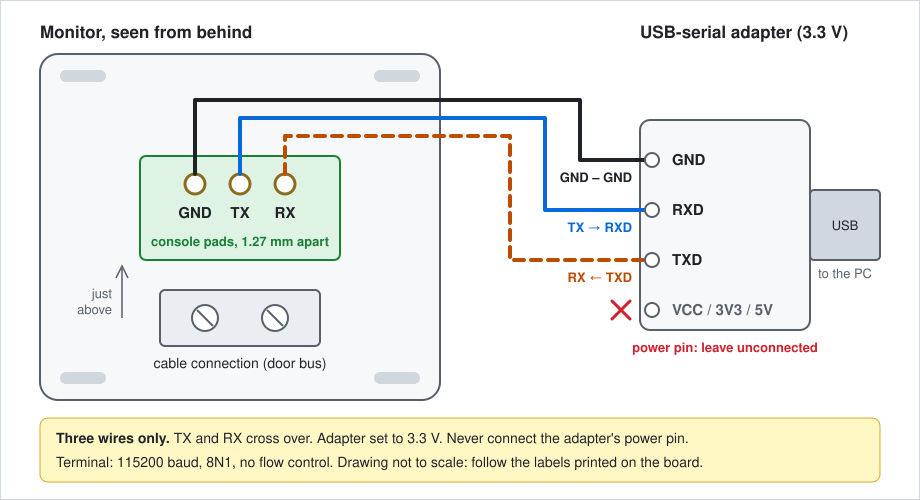
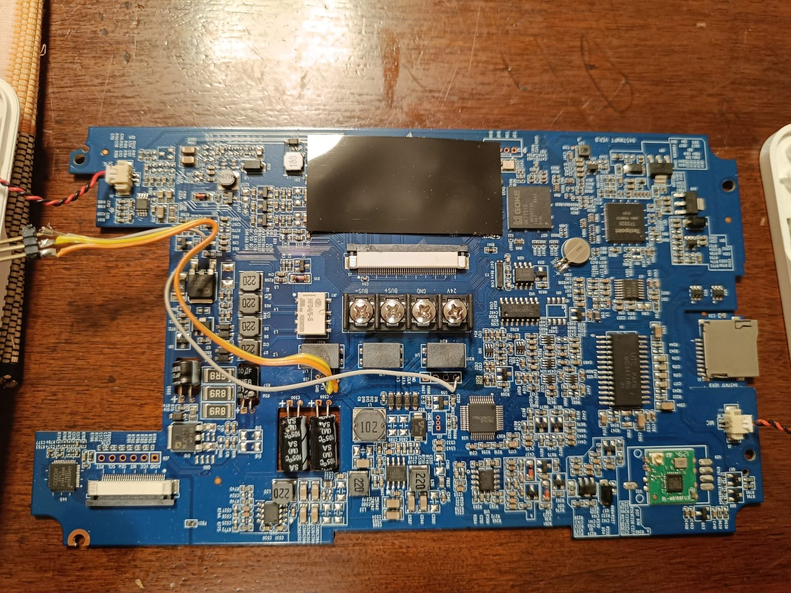

# 1 — Connect to the monitor's serial console

The monitor has a hidden service connection (a "serial console", also called UART). It is the only
way in the first time. You need it **once**, for about 15 minutes; afterwards everything is done over
your home network.

Nothing in this step changes the monitor.

## What you need

| | |
|---|---|
| **USB‑serial adapter, 3.3 V** | A small USB stick with pins, about 5 €. Common types: FT232RL (the one used for this guide), CP2102, CH340. It **must** be set to **3.3 V** (jumper or switch on the adapter). 5 V can damage the monitor. |
| **A way to touch three tiny pads** | The pads are **1.27 mm apart** — half the size of ordinary jumper wires, which do not fit. See [Make the connection](#3-make-the-connection). |
| **A PC** | Windows 10/11 or Linux, with [Python 3](https://www.python.org/downloads/) installed (Windows: tick **"Add python.exe to PATH"** in the installer). |

## 1. Find the pads

Take the monitor off the wall so you can see its back. **Leave its cable connected** — the monitor
gets its power from it.

The three pads are **visible from the back of the monitor, just above the cable connection**. They are
marked on the board:

```
GND   TX   RX
```





*The monitor's main board (component side). Find the three pads by the printed label `GND TX RX`
next to the square chip U38; compare with the labels on your board before soldering.*
> **Only use the group marked exactly `GND TX RX`.** The board has other pad groups that look similar
> (`TXP TXN RXP RXN`, or `GND SCLK DATA 3V3`). They are **not** serial consoles; connecting the adapter
> there can damage the monitor.

## 2. Three wires, crossed

| Monitor pad | goes to adapter pin |
|---|---|
| `GND` | `GND` |
| `TX` | `RXD` (also written RX) |
| `RX` | `TXD` (also written TX) |

TX and RX **cross over**: what the monitor sends (TX) the adapter receives (RXD). Do **not** connect
the adapter's power pin (`VCC`, `3V3` or `5V`) to anything.

## 3. Make the connection

Pick whichever you are comfortable with. The connection must stay steady for the whole of step 2.

- **Soldering (most reliable).** Solder three thin wires (for example wire‑wrap wire, AWG 30) to the
  pads and plug the other ends onto the adapter. You can leave them in place afterwards.
- **No soldering: a 1.27 mm pogo‑pin probe.** Spring‑loaded test pins with the right spacing; search
  for *"pogo pin probe 1.27 mm 3P"*. Press it onto the pads and fix it with tape or a clamp.
- **No soldering: a 1.27 mm pin header.** If the pads are holes, a 3‑pin header strip with 1.27 mm
  spacing pushed in at a slight angle holds by friction.

## 4. Plug in the adapter and find its port

Plug the adapter into the PC (the monitor side can already be connected).

**Windows** — open *Device Manager* → **Ports (COM & LPT)**. The adapter appears as
*USB Serial Port (COM7)* or similar; remember the number. If it shows up under *Other devices* with a
warning sign, install the driver for your adapter's chip (FTDI, CP210x or CH340 — from the chip
maker's website) and plug it in again.

**Linux** — the adapter is `/dev/ttyUSB0` (check with `ls /dev/ttyUSB*`). Allow yourself to use it
once, then log out and in again:

```sh
sudo usermod -aG dialout $USER
```

## 5. Open the terminal

The same small terminal program works on both systems.

**Windows** (in a *Command Prompt* or *PowerShell* window; replace `COM7` with your port):

```
python -m pip install pyserial
python -m serial.tools.miniterm COM7 115200
```

**Linux:**

```sh
sudo apt install -y python3-serial
python3 -m serial.tools.miniterm /dev/ttyUSB0 115200
```

How to use it:

- **Leave** the terminal: `Ctrl` + `]`.
- **Paste** into it: **right‑click** on Windows (not `Ctrl+V`), `Ctrl+Shift+V` on Linux.
- Keep this window open for all of step 2.

<details>
<summary>Other terminal programs</summary>

Any serial terminal works with these settings: **115200 baud, 8 data bits, no parity, 1 stop bit,
no flow control**. Windows: [PuTTY](https://www.putty.org/) (Connection type *Serial*, your COM port,
speed 115200; under *Connection → Serial* set *Flow control* to *None*). Linux:
`picocom -b 115200 /dev/ttyUSB0` (leave with `Ctrl+A` then `Ctrl+X`).
</details>

## 6. Test it

Switch the monitor **off and on** (switch off the power supply of the door‑entry kit, wait 5 seconds,
switch it on).

Within a few seconds some characters and a short countdown (`2 … 1 … 0`) appear in the terminal.
The very first characters may be garbled, and after the countdown the terminal may stay silent while
the monitor starts normally — both are normal.

**That is all for this step.** If you saw text, the connection works: continue with
[step 2](02-root-and-backup.md).

## If nothing appears

| What you see | Try this |
|---|---|
| Nothing at all | Swap the `TX` and `RX` wires (the most common mistake — it does no harm). Check `GND`. Check the contact on the pads. |
| Nothing at all, wiring is right | Wrong port: close the terminal and open it on the other COM port / `ttyUSB` number. |
| Only unreadable characters, all the time | The speed is wrong: it must be `115200`. |
| *"could not open port"* / *"Access is denied"* | Another program (or a second terminal window) is using the port — close it. Linux: you have not logged out and in after the `usermod` line. |
| Text appears, but your typing does nothing (step 2) | The wire from the adapter's `TXD` to the monitor's `RX` has no contact. |
